<p align="center">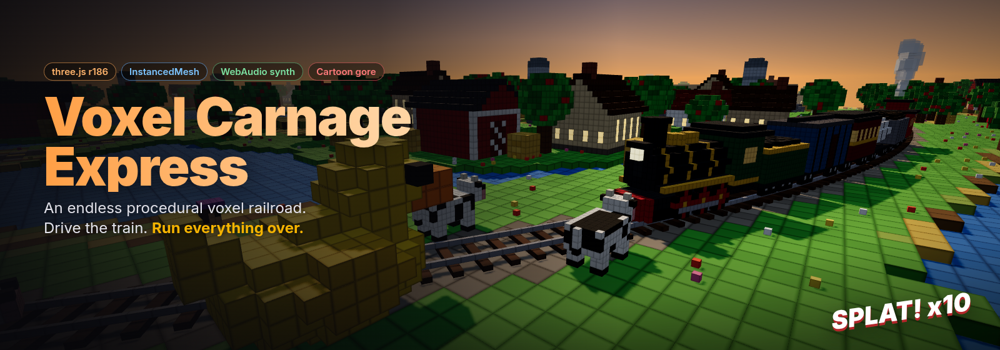</p>

<p align="center">
  
  
  
  
  
  
</p>

<h3 align="center">An endless procedural voxel railroad. You drive. Everything else gets flattened.</h3>

---

**Voxel Carnage Express** is a browser game built in three.js where a chunky voxel steam train barrels down a track that never ends. Cows, clowns, pedestrians, aliens, a T-Rex, a grand piano, a full marching band and UFOs landing on the rails all wander into your path. Hit them hard enough and they explode into physics-driven voxel chunks, spray blood (or green goo, or oil and sparks, or confetti) across the countryside, paint your locomotive red, and earn a slow-motion instant replay.

Every voxel is placed by code. Every sound is synthesized live. There is not a single texture, model or audio file in this repo.

<p align="center">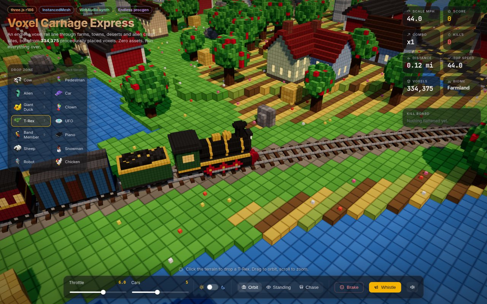</p>

## The pitch, in screenshots

| Gore | Instant replay |
|:--:|:--:|
| 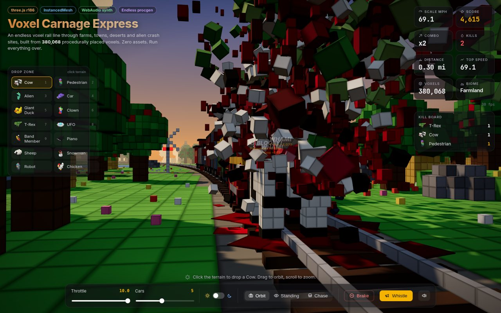 | 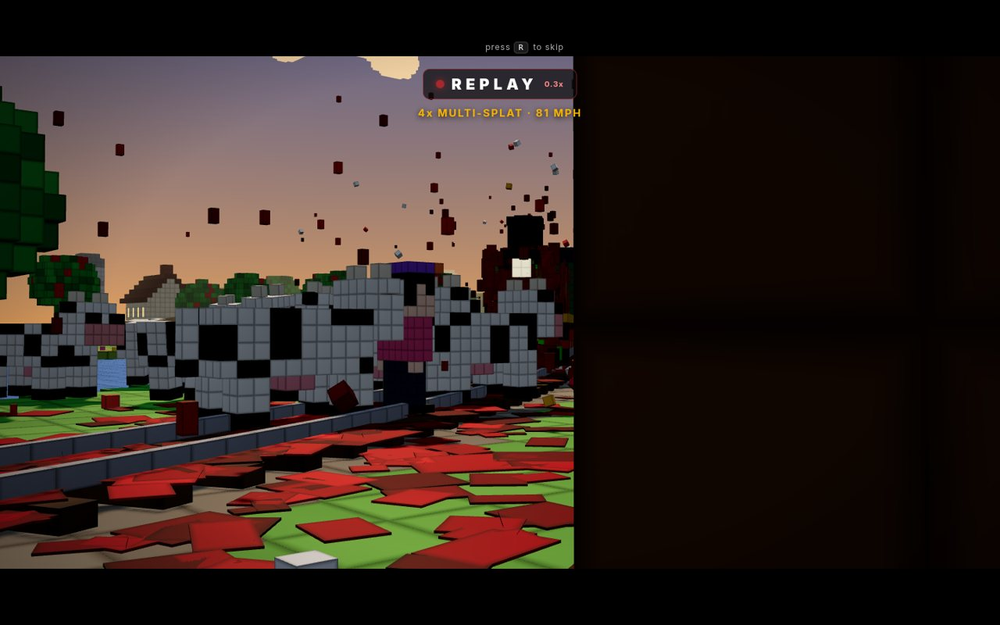 |
| **T-Rex vs. 4-6-0.** Bodies burst into tumbling voxels, meat chunks and blood spray that splats into decals on the ballast. | **REPLAY.** Combos, rare targets and big-speed hits roll the tape back and play it at 0.3x from a cinematic angle. |
| 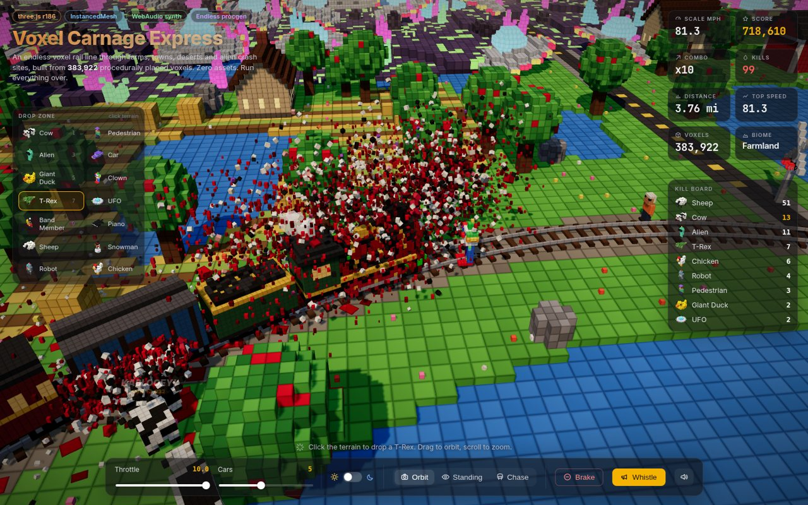 | 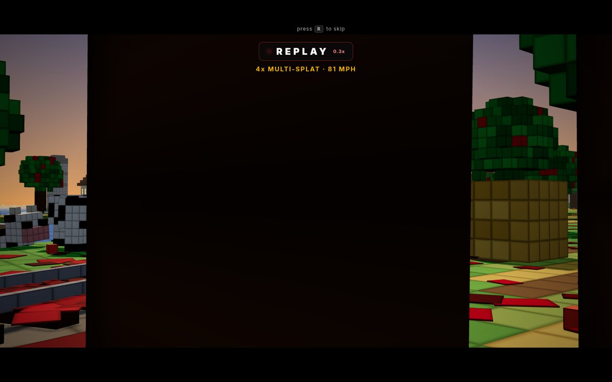 |
| **Multi-splat.** Line up a herd, hit it at 80 scale MPH, watch the combo meter max out. | **Rail cam.** One of three replay angles puts you on the sleepers with the train charging at the lens. |

### Biomes that stream forever

| Desert | Snowfields |
|:--:|:--:|
| 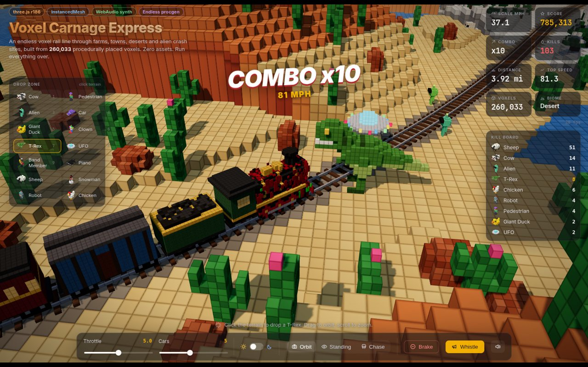 | 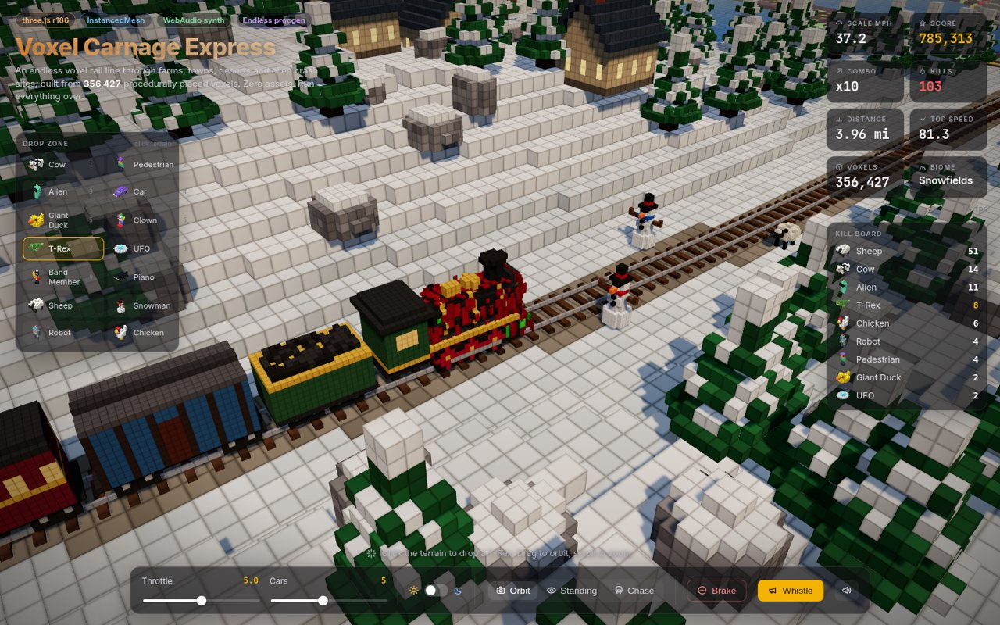 |
| **Alien crash site** | **Town (and a marching band)** |
| 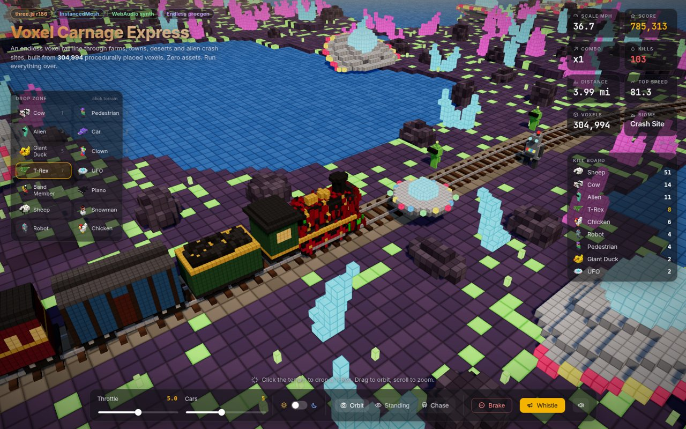 | 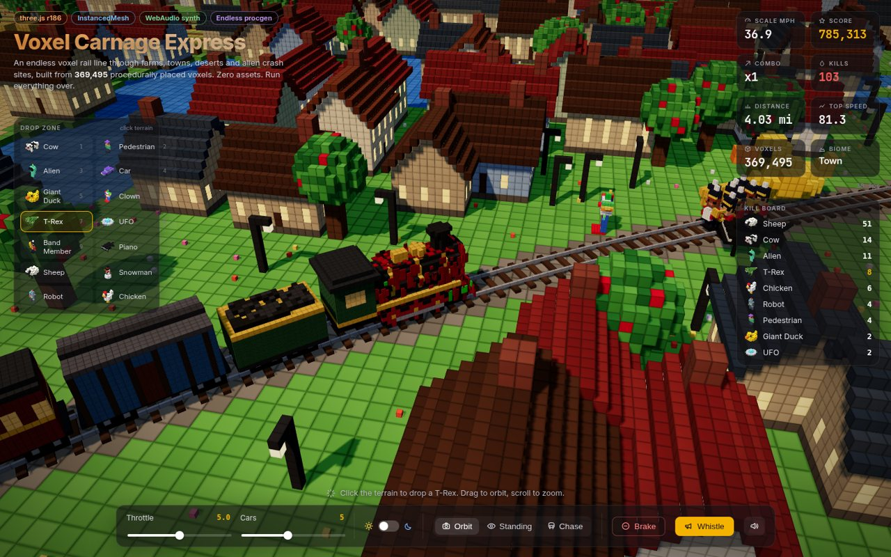 |

<p align="center">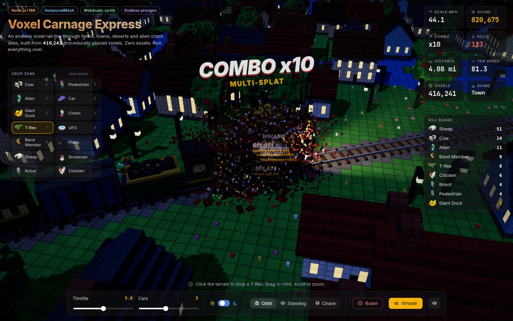<br><sub>Night mode: headlight, glowing windows, sparks.</sub></p>

## Features

- **Endless world.** 32x32 voxel chunks are generated in a ring ahead of the train and disposed behind it. Six biomes (farmland, town, forest, desert with mesas, snowfields, alien crash site) come from a jittered Voronoi over big cells, so every run is a road trip.
- **A track that wanders.** The rail line is a sum-of-sines heading curve, always trending forward, with road crossings (crossbucks, dashed yellow lines, crossing bells) and cars timed to arrive just as you do.
- **14 things to hit.** Cow, pedestrian, alien, car, giant rubber duck, clown, T-Rex, UFO, marching band, grand piano (dropped from the sky, naturally), sheep stampede, snowman, robot, chicken.
- **Spawn palette.** Pick a target in the Drop Zone (or press 1 to 9), click the terrain, and it falls out of the sky and heads for the rails.
- **Whistle lure.** The whistle does not scare anything. It makes every curious critter within 60m sprint onto the track.
- **Voxel gore engine.** Fixed-size `InstancedMesh` pools for body chunks, blood droplets, glowing sparks/confetti and ground decals. Bleed styles per target: red, green (aliens), oil + sparks (robots, cars, UFOs), confetti (ducks), snow, piano splinters. Blood also smears onto the locomotive itself.
- **Instant replays.** A 7 second ring buffer records train arc-length and every target pose each frame, plus hit events with their RNG seeds. Replays restore that history and re-run the explosions deterministically in slow motion. `R` skips.
- **Scoring.** Points scale with type, speed and a combo multiplier (up to x10). HUD cards track score, combo, kills, distance, top speed, live voxel count and biome, plus a kill board with procedurally rendered isometric icons.
- **All-synth audio.** Chuffs keyed to wheel distance, a four-note chime whistle, splats, moos, screams, alien squeals, T-Rex roars, robot bleeps, piano chord crashes, crossing bells. Pitched down during replays. `M` mutes.
- **Adaptive quality.** If the frame rate dips under ~48fps the game drops pixel ratio, view radius, then shadow resolution, one notch at a time.

## Controls

| Key | Action |
|---|---|
| `W` / `S` | Throttle up / down. Hold `S` at zero throttle to brake |
| `B` or **Brake** button | Brake (hold) |
| `Space` | Whistle (lures critters onto the track) |
| `C` | Cycle camera: Orbit, Standing, Chase |
| `R` | Skip replay |
| `N` | Day / night |
| `M` | Mute |
| `1` to `9` | Pick a Drop Zone target |
| Click terrain | Drop the selected target |
| Drag / scroll | Orbit / zoom (Orbit camera) |

## Run it

```bash
npm install
npm run dev          # hot reload on http://localhost:5199
npm run build        # static bundle in dist/
npm run serve        # serves dist/ on 0.0.0.0:$PORT (default 5199)
PORT=8080 npm run serve
```

No Node on the target box? Use the prebuilt tarball:

```bash
tar xzf voxel-carnage-express-dist.tar.gz
cd voxel-carnage-express-dist
./serve.sh           # python3 -m http.server on 0.0.0.0:${PORT:-5199}
```

Then open `http://localhost:5199/`. URL knobs: `?seed=42` for a different world, `?radius=110` for a shorter view distance on weaker GPUs.

## Architecture

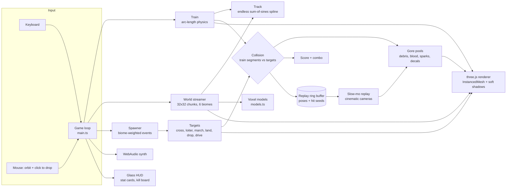

| File | What lives there |
|---|---|
| `src/track.ts` | Endless spline, crossings, nearest-point queries via binary search (z is monotonic along the track) |
| `src/world.ts` | Chunk generation and disposal, biomes, terrain height, ponds, mesas, props |
| `src/models.ts` | Every voxel model: train, cars, targets, houses, barns, trees, cacti, crystals, UFO wreck |
| `src/voxels.ts` | Shared cube geometry, procedural bevel texture, voxel list to `InstancedMesh` |
| `src/train.ts` | Throttle/brake physics, car placement from bogie points, blood smears on the loco |
| `src/targets.ts` | Target registry: points, bleed style, sound, speed, biome spawn weights |
| `src/gore.ts` | Particle pools with gravity, bounce, settle and decal splats; snapshot/restore for replays |
| `src/audio.ts` | WebAudio synthesis for everything you hear |
| `src/ui.ts` | HUD, kill board, Drop Zone chips with canvas-rendered iso voxel icons |
| `src/main.ts` | Game loop, spawning, behaviors, collisions, scoring, replay director, cameras |

## Performance notes

- Static world voxels are baked into one `InstancedMesh` per chunk (plus a tiny unlit one for glowing windows and crystals). Around 250k to 400k voxels are live at once, in roughly 100 draw calls.
- Gore uses four fixed pools totalling about 21k instances. No allocation per hit.
- Chunk generation is time-sliced at 4ms per frame. A chunk takes 1 to 6ms to build.
- Simulation costs about 1.5ms per frame on the CPU. The GPU is the budget, and a 12GB card has plenty.

## Verification

`scripts/shoot.py` drives the production build in headless Chrome (SwiftShader GL) through the `window.__vce` debug hooks: it drives 90 simulated seconds to confirm chunk streaming, lines up a herd to confirm gore, waits for the auto replay, teleports through every biome and checks the console stays clean. `scripts/make_docs.py` renders the banner and README screenshots from the live game.

## License

MIT. Go run something over.
